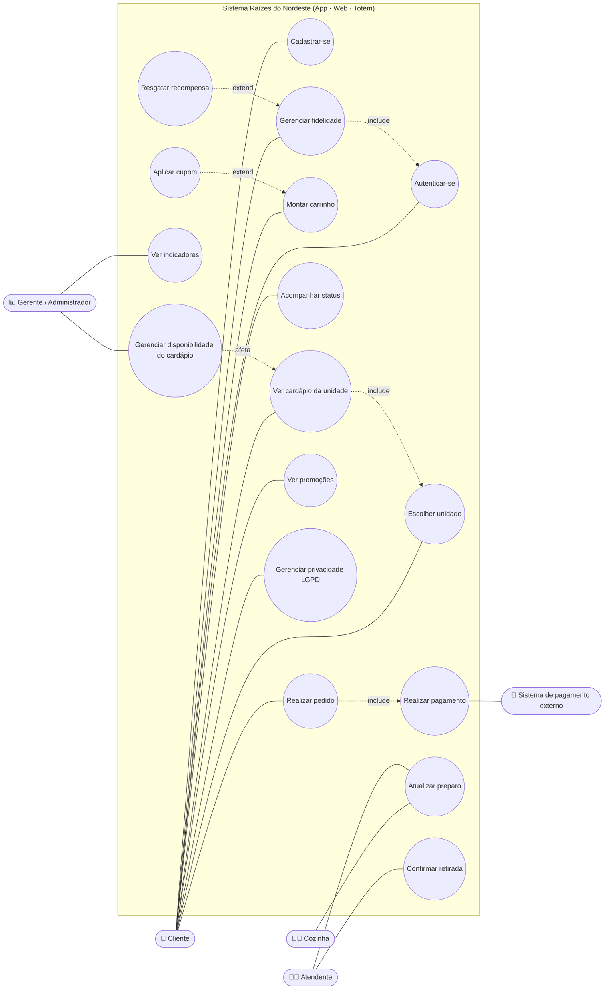
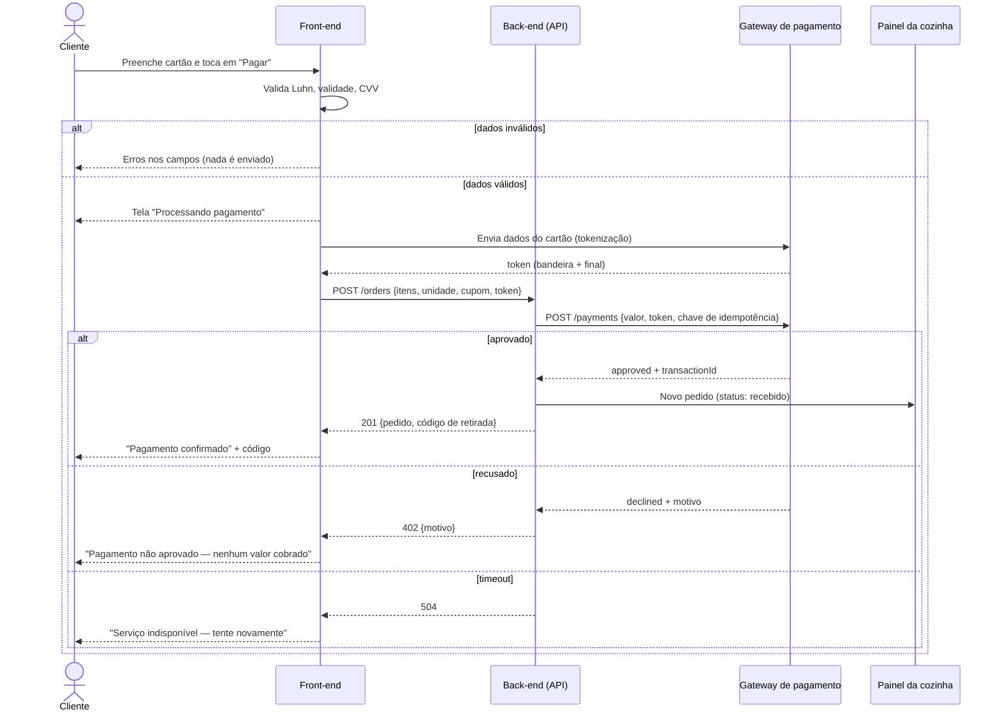
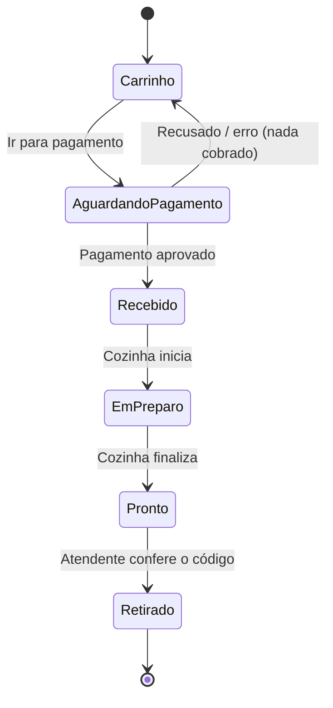

# 2. Diagrama de casos de uso

> O GitHub desenha os diagramas Mermaid automaticamente. Para o PDF, abra este arquivo no GitHub ou cole o código em <https://mermaid.live> e exporte em PNG/SVG.

**Leitura do diagrama:** "Realizar pedido" sempre *inclui* "Realizar pagamento", que conversa com o sistema externo. "Aplicar cupom" *estende* o carrinho (é opcional). Quando o gerente desliga um item, isso afeta direto o cardápio visto pelo cliente em todos os canais.

---

## 2.1 Descrição de feature: **Realizar pagamento** (UC8)

| Campo | Descrição |
|---|---|
| **Ator principal** | Cliente |
| **Ator secundário** | Sistema de pagamento externo (gateway) |
| **Objetivo** | Pagar o pedido por Pix ou cartão e receber a confirmação visual |
| **Pré-condições** | 1) Unidade escolhida. 2) Carrinho com pelo menos 1 item disponível. 3) Cliente autenticado (web/app) **ou** nome informado (totem). 4) Cupom aplicado, se houver, válido. |
| **Pós-condição de sucesso** | Pedido criado com status "Pagamento confirmado", código de retirada gerado, pontos creditados, carrinho esvaziado e cozinha avisada |
| **Pós-condição de falha** | Nenhum pedido criado, nenhum valor cobrado, carrinho preservado |

### Fluxo principal (cartão)
1. O cliente toca em **Ir para pagamento** no carrinho.
2. O sistema mostra o resumo, a forma de recebimento e as formas de pagamento.
3. O cliente escolhe **Cartão de crédito** e preenche número, nome, validade e CVV.
4. O sistema valida no navegador: algoritmo de Luhn, validade não vencida (MM/AA), CVV de 3–4 dígitos.
5. O sistema mostra a tela **Processando pagamento**, com 3 etapas visuais: *pedido validado → enviando ao provedor → aguardando resposta do banco*.
6. O sistema envia `{ método, valor, dados do cartão }` **direto ao gateway externo** (`POST /payments`).
7. O gateway responde `approved` com `transactionId` e um token (bandeira + 4 últimos dígitos).
8. O sistema descarta os dados do cartão da memória, cria o pedido, gera o código de retirada, credita os pontos e redireciona para **Acompanhar pedido**.

### Fluxo alternativo A — Pix
- 3a. O cliente escolhe **Pix** e confirma.
- 6a. O gateway responde `pending` com o código Pix e o prazo de expiração (5 min).
- 7a. O sistema mostra o QR Code, o botão **Copiar** e a contagem regressiva, e consulta o status a cada segundo (`GET /payments/:id`).
- 8a. Quando o status vira `approved`, segue no passo 8. Se expirar, vai para a exceção E3.

### Exceções
| Código | Situação | Tratamento na interface |
|---|---|---|
| E1 | Dados do cartão inválidos (passo 4) | Mensagem abaixo do campo, borda vermelha, foco no primeiro campo com erro. Nada é enviado ao gateway |
| E2 | Gateway recusa (saldo, operadora) | Tela "Pagamento não aprovado" com o motivo, **"Nenhum valor foi cobrado"**, botões *Tentar novamente* e *Pagar com Pix* |
| E3 | Pix expira | Tela de erro com opção de gerar um novo pagamento |
| E4 | Falha de comunicação / timeout | Tela "Serviço de pagamento indisponível", carrinho preservado, nova tentativa |
| E5 | Cupom deixou de valer (ex.: mudou o dia) | Alerta no topo do formulário pedindo para remover o cupom |
| E6 | Cliente cancela o Pix | Volta ao formulário e a consulta de status é interrompida |

### Como o sistema lida com o processamento externo
- **Contrato isolado:** toda a comunicação fica em `js/payment.js`. Trocar o simulador pelo gateway real (Mercado Pago, Stripe, PagSeguro…) não mexe na interface.
- **Assíncrono com feedback:** a interface nunca fica "congelada"; cada estado (enviando, aguardando, aprovado, recusado, erro) tem uma tela própria.
- **Idempotência (em produção):** o back-end envia uma chave de idempotência por pedido para que um duplo clique não gere duas cobranças. Na interface, o botão some enquanto o pagamento é processado.
- **Confirmação no servidor (em produção):** o status final vem por *webhook* do gateway para o back-end; o front só exibe o que o back-end confirmar.
- **PCI/LGPD:** os dados do cartão não passam pelo nosso servidor nem são guardados (tokenização).

## 2.2 Diagrama de sequência — pagamento com cartão

> **Na demonstração**, a API e o gateway são simulados no próprio navegador (`payment.js`), com o mesmo formato de resposta.

## 2.3 Diagrama de estados do pedido

---
**Imagens prontas para o PDF:** [`diagramas/casos-de-uso.png`](diagramas/casos-de-uso.png) · [`diagramas/sequencia-pagamento.png`](diagramas/sequencia-pagamento.png) · [`diagramas/estados-pedido.png`](diagramas/estados-pedido.png)
