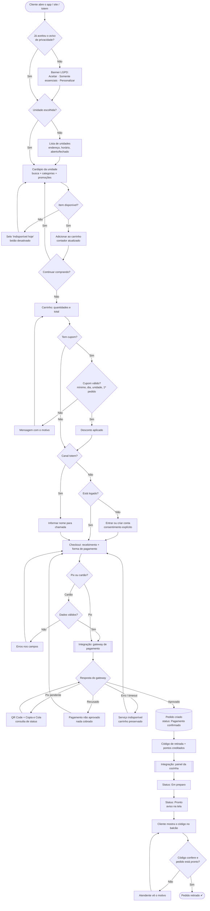

# 3. Jornada do usuário

Percurso do cliente **do primeiro contato com o cardápio até o pagamento confirmado e a retirada do pedido**, com etapas, decisões, estados do sistema e integrações.

## 3.1 Diagrama da jornada

**Legenda:** losangos = decisões · retângulos = telas/ações · `[[ ]]` = integrações externas ou entre módulos · `[( )]` = estado gravado.

## 3.2 Mapa da jornada (emoções e oportunidades)

| Etapa | O que o cliente faz | Tela | Estado do sistema | Sentimento | Decisão de interface |
|---|---|---|---|---|---|
| 1. Descoberta | Abre o site pelo link ou QR na loja | Aviso LGPD + unidades | Sem consentimento | Curioso | Banner com botões de mesmo peso; nada é rastreado antes da escolha |
| 2. Unidade | Escolhe onde vai retirar | Lista de unidades | `unitId` definido | Orientado | Mostra "Aberto agora" para evitar frustração |
| 3. Cardápio | Busca, filtra, adiciona | Cardápio | Carrinho em memória/local | Com fome 😋 | Preço visível em todo cartão; itens esgotados vão para o fim, com selo |
| 4. Carrinho | Revisa e aplica cupom | Carrinho | Totais recalculados | Atento ao preço | O motivo do cupom inválido aparece na hora (ex.: "Pedido mínimo de R$ 40") |
| 5. Identificação | Entra ou cria conta (web) / informa o nome (totem) | Login/Cadastro | Sessão criada | Pode desistir ⚠️ | Só 3 campos obrigatórios; o login volta direto para o pagamento |
| 6. Pagamento | Escolhe Pix ou cartão | Checkout | Aguardando gateway | Ansioso | Etapas visuais do processamento; aviso de que o cartão não é armazenado |
| 7. Retorno | Vê aprovado/recusado | Status do pagamento | Pedido criado ou não | Aliviado / frustrado | A recusa explica o motivo, garante que "nada foi cobrado" e oferece o Pix |
| 8. Espera | Acompanha o preparo | Acompanhar pedido | recebido → em preparo → pronto | Tranquilo | Linha do tempo com horários; aviso quando fica pronto |
| 9. Retirada | Mostra o código | Código grande na tela | retirado | Satisfeito 😊 | Código curto (letra + 3 números), fácil de falar no balcão |
| 10. Fidelização | Vê os pontos ganhos | Fidelidade | Pontos creditados | Valorizado | Barra de progresso até o próximo nível incentiva a voltar |

---
**Imagem pronta para o PDF:** [`diagramas/jornada-do-usuario.png`](diagramas/jornada-do-usuario.png)
