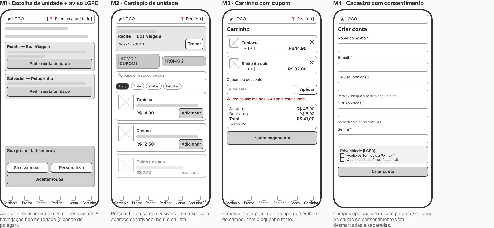
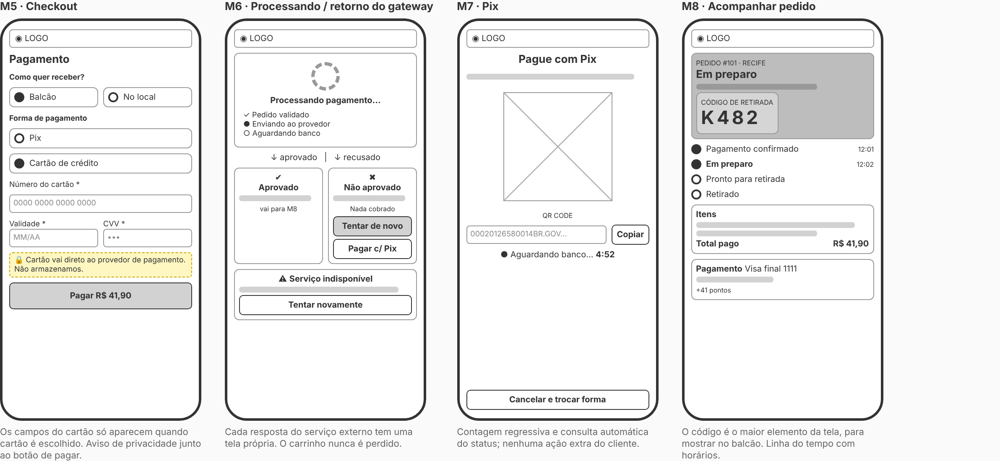
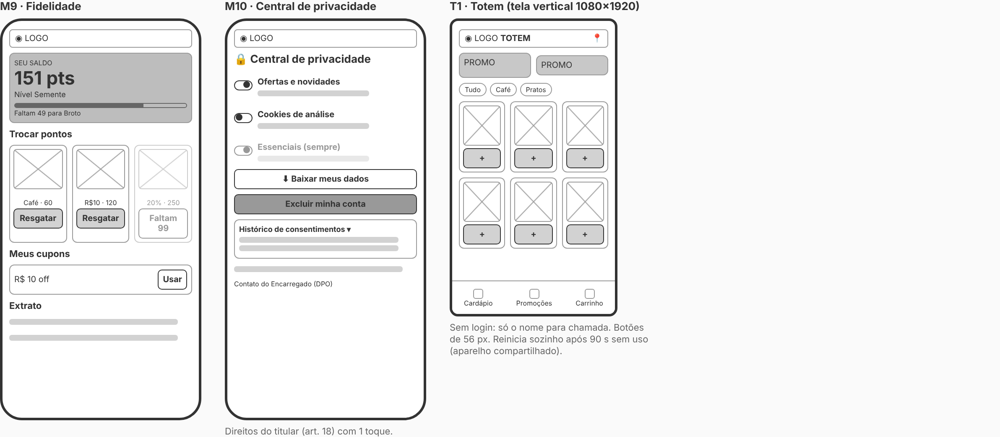
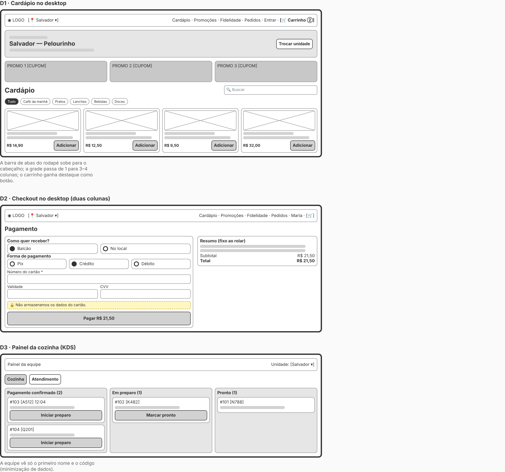

# 4. Wireframes, protótipo e arquitetura da interface

## 4.1 Wireframes de baixa fidelidade

Os wireframes foram feitos **antes** do código para validar a arquitetura de informação (o que aparece em cada tela e em que ordem). Fonte editável: [`wireframes/index.html`](wireframes/index.html), que pode ser aberta no navegador.

| Fluxo | Telas | Imagem |
|---|---|---|
| 1 — Do cardápio ao carrinho (mobile) | M1 Unidade + aviso LGPD · M2 Cardápio · M3 Carrinho · M4 Cadastro |  |
| 2 — Pagamento e acompanhamento (mobile) | M5 Checkout · M6 Retorno do gateway · M7 Pix · M8 Status |  |
| 3 — Fidelidade, privacidade e totem | M9 Fidelidade · M10 Central de privacidade · T1 Totem |  |
| 4 — Desktop | D1 Cardápio · D2 Checkout em 2 colunas · D3 Painel da cozinha |  |

### Decisões de arquitetura de informação
1. **Unidade primeiro.** Como preço e disponibilidade mudam por loja (RN01), a unidade é escolhida antes do cardápio e fica sempre visível no topo.
2. **Navegação no polegar.** No celular, as 6 seções ficam numa barra fixa no rodapé; no desktop sobem para o cabeçalho.
3. **Carrinho sempre a um toque**, com contador de itens.
4. **Identificação só no fim.** O cliente monta o pedido sem precisar de conta; o login é pedido só no pagamento e volta direto para ele.
5. **Um estado, uma tela** no pagamento: processando, Pix, aprovado, recusado e indisponível.
6. **Código de retirada em destaque**, por ser o que o cliente precisa mostrar no balcão.
7. **Privacidade perto da ação:** aviso de cartão ao lado do botão de pagar; finalidade explicada em cada campo opcional.

## 4.2 Design responsivo (mobile-first)

| Faixa | Layout |
|---|---|
| < 600 px (celular) | 1 coluna; abas no rodapé; promoções em carrossel horizontal; cartão de produto em linha (ícone à esquerda) |
| 600–899 px (tablet) | Grade de 2 colunas; promoções lado a lado; item do carrinho em uma linha |
| ≥ 900 px (desktop) | Navegação no topo; grade de 3 colunas; páginas em 2 colunas (conteúdo + resumo fixo); cozinha em 3 colunas |
| ≥ 1200 px | Grade de 4 colunas |
| Totem (`body.totem`) | Fonte 18 px; alvos de toque de 56 px; só Cardápio, Promoções e Carrinho |

## 4.3 Identidade visual

| Token | Cor | Uso |
|---|---|---|
| Terracota `#B5482A` | Barro, telha | Ação principal (botões, preço, aba ativa) |
| Mandacaru `#2F6B4F` | Caatinga | Sucesso, promoções, "pronto" |
| Sol `#F2B544` | Sertão | Cupons, foco do teclado, destaques |
| Areia `#FBF3E8` | — | Fundo |
| Barro escuro `#2B1D14` | — | Texto (contraste AAA sobre areia) |

Tipografia: serifada (Georgia) nos títulos, remetendo a cordel e tradição; fonte do sistema no texto, para carregar rápido.

## 4.4 Tecnologias escolhidas

| Escolha | Motivo |
|---|---|
| **HTML, CSS e JavaScript puros (ES Modules)** | Zero dependências e zero etapa de build: carrega rápido em 3G, roda direto no GitHub Pages e mostra domínio dos fundamentos |
| **SPA com roteamento por hash** (`#/rota`) | Funciona em hospedagem estática sem configurar o servidor; cada tela tem um endereço próprio (botão voltar funciona) |
| **Dados simulados** (`js/data.js`) | Substituem a API conforme o roteiro; mesmo formato que o back-end devolveria |
| **localStorage** | Simula o banco de dados para a demonstração funcionar entre recarregamentos |
| **Node test runner** + **GitHub Actions** | Testes das regras de negócio sem instalar nada; o deploy só acontece se os testes passarem |

## 4.5 Estrutura do código

```
index.html            → casca da página (cabeçalho, <main>, rodapé, modal, avisos)
css/styles.css        → estilos mobile-first + breakpoints + modo totem
js/core.js            → regras puras: validações, cupons, totais, pontos, status (testadas)
js/data.js            → mock: unidades, cardápio, promoções, recompensas
js/store.js           → estado + persistência + hash de senha + analytics com consentimento
js/payment.js         → simulador do gateway de pagamento externo
js/app.js             → telas, rotas, eventos e simulação da cozinha
tests/core.test.mjs   → 11 testes unitários
```

## 4.6 Relação com o back-end (contrato de API proposto)

O front foi escrito para trocar os mocks por chamadas HTTP sem mudar as telas:

| Tela | Endpoint | Substitui |
|---|---|---|
| Unidades | `GET /units` | `UNITS` |
| Cardápio | `GET /units/{id}/menu` | `menuForUnit()` |
| Cadastro / login | `POST /auth/register`, `POST /auth/login` → JWT | `hashPassword()` + `state.users` |
| Cupom | `POST /promotions/validate` | `evaluatePromo()` (o servidor revalida sempre) |
| Pedido + pagamento | `POST /orders` → `POST /payments` (gateway) → webhook | `requestPayment()` |
| Status | `GET /orders/{id}` ou WebSocket/SSE | `setInterval` da simulação |
| Fidelidade | `GET /me/loyalty`, `POST /me/loyalty/redeem` | `user.points` |
| LGPD | `GET /me/data`, `PATCH /me/consents`, `DELETE /me` | botões da Central de privacidade |
| Cozinha / atendimento | `PATCH /orders/{id}/status` | `advanceOrder()` |
| Gerência | `GET /reports`, `PATCH /units/{id}/menu/{item}` | `state.overrides` |

> As validações no front servem para a **experiência** (erro na hora). As regras críticas (preço, cupom, pontos, status) são sempre **revalidadas no servidor**.
