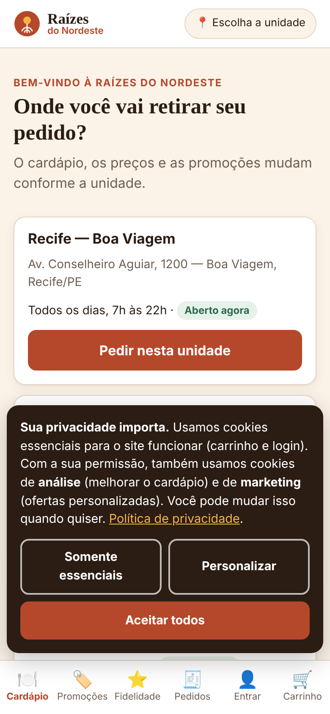
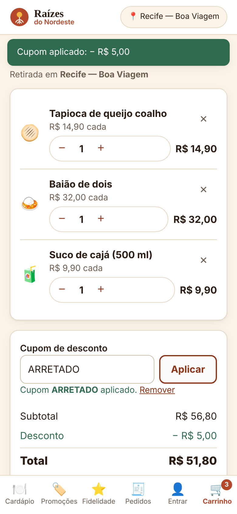
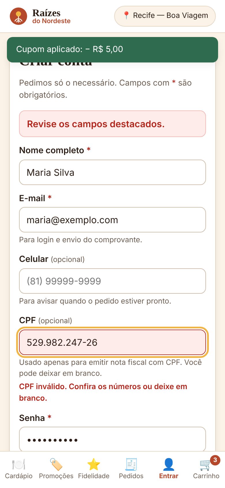
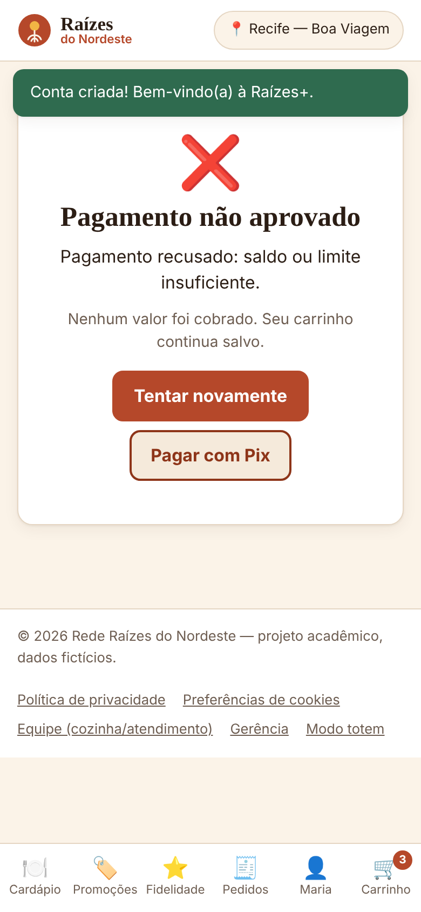
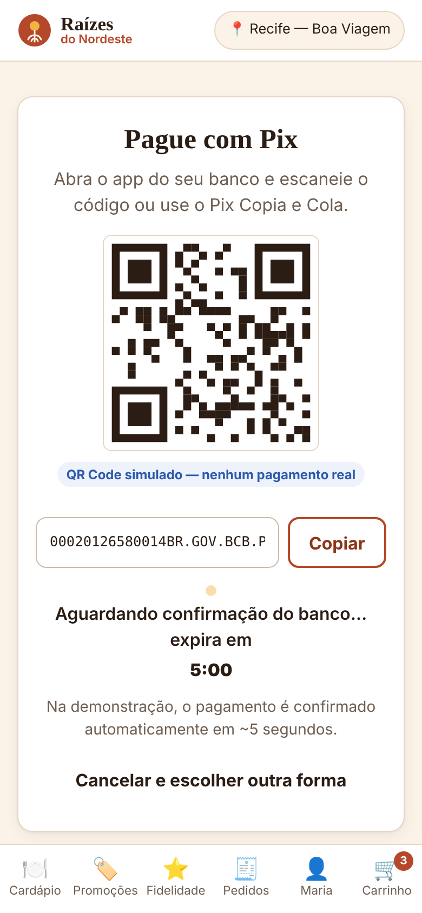
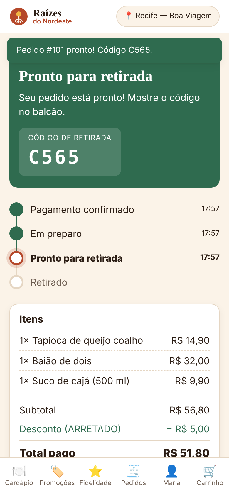
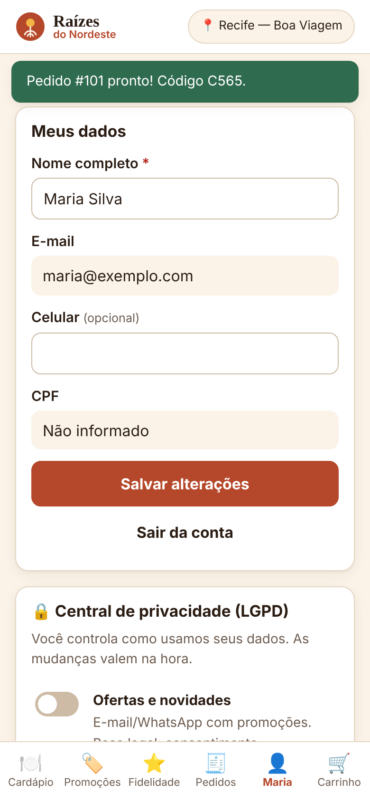
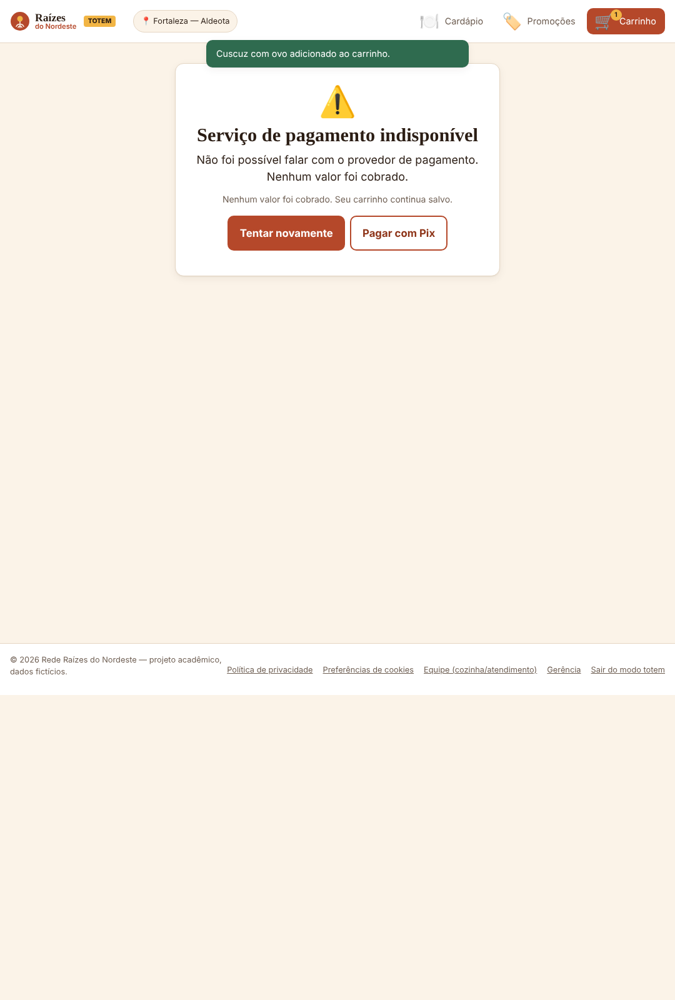

# 6. Plano de testes

## 6.1 Estratégia

| Nível | O que valida | Ferramenta | Como rodar |
|---|---|---|---|
| **Unitário** | Regras de negócio: validações, cupons, totais, pontos, status | `node:test` (nativo) | `npm test` — roda também no GitHub Actions antes de cada deploy |
| **Ponta a ponta (E2E)** | Fluxos completos no navegador, incluindo erros | Playwright | `python tests/e2e/e2e_playwright.py . docs/evidencias` |
| **Responsividade** | Layout em 390 px (celular), 1080 px (totem) e 1366 px (desktop) | Playwright + DevTools | Prints em `docs/evidencias/` |
| **Usabilidade** | Clareza do fluxo para pessoas reais | Teste moderado com 5 participantes | Roteiro em 6.4 |
| **Acessibilidade** | Teclado, leitor de tela, contraste | Lighthouse / navegação só por Tab | Checklist em 6.5 |
| **Privacidade (LGPD)** | Consentimento, transparência, direitos do titular | Cenários CT-14 a CT-18 | Manual + E2E |

**Critério de aceite geral:** 100% dos testes unitários passando, todos os cenários de prioridade alta aprovados e nenhum erro no console do navegador.

## 6.2 Cenários de teste (positivos e negativos)

Legenda de tipo: ✅ positivo · ❌ negativo. Coluna **Auto**: coberto pelo teste E2E automatizado (E2E) ou unitário (U).

| ID | Tipo | Requisito | Pré-condição | Entrada / passos | Resultado esperado | Auto |
|---|---|---|---|---|---|---|
| CT-01 | ✅ | RF03 | Primeira visita | Escolher "Recife — Boa Viagem" | Cardápio da unidade aparece com preços de Recife e selo Aberto/Fechado | E2E |
| CT-02 | ✅ | RF03, RN01 | Unidade Salvador | Abrir o cardápio | "Acarajé completo" por R$ 16,00; em Fortaleza o item não aparece | U |
| CT-03 | ❌ | RF03, RN02 | Unidade Fortaleza | Procurar "Caldo de cana" | Item com selo **"Indisponível hoje"** e sem botão Adicionar | U |
| CT-04 | ✅ | RF05 | Cardápio aberto | Adicionar tapioca, baião e suco | Contador do carrinho = 3; total R$ 56,80 | E2E |
| CT-05 | ✅ | RF06 | Carrinho com cartola (Recife) | Trocar para Salvador | Cartola sai do carrinho; aviso "Alguns itens não existem nesta unidade…" | Manual |
| CT-06 | ✅ | RF07 | Subtotal R$ 56,80 | Cupom `ARRETADO` | "Cupom ARRETADO aplicado"; desconto − R$ 5,00; total R$ 51,80 | E2E |
| CT-07 | ❌ | RF07 | Unidade Recife | Cupom `CUSCUZSSA` | Erro: **"Cupom não válido nesta unidade."**; total sem desconto | E2E |
| CT-08 | ❌ | RF07 | Subtotal R$ 39,90 | Cupom `ARRETADO` | Erro: **"Pedido mínimo de R$ 40,00 para este cupom."** | U |
| CT-09 | ❌ | RF07 | Segunda-feira | Cupom `SEXTOU` | Erro: **"Cupom não válido hoje."** | U |
| CT-10 | ❌ | RF07 | Cliente com 1 pedido | Cupom `BEMVINDO10` | Erro: **"Cupom válido apenas no primeiro pedido."** | U |
| CT-11 | ❌ | RF01 | Tela de cadastro | Enviar o formulário vazio | Alerta "Revise os campos destacados"; erros em Nome, E-mail, Senha e Termos; foco no primeiro campo | E2E |
| CT-12 | ❌ | RF01 | Tela de cadastro | CPF `529.982.247-26` | **"CPF inválido. Confira os números ou deixe em branco."** | E2E |
| CT-13 | ❌ | RF01 | Tela de cadastro | Senha `12345678` | **"A senha precisa de 8+ caracteres, com letras e números."** | U |
| CT-14 | ❌ | RF01 | E-mail já cadastrado | Cadastrar o mesmo e-mail | **"Já existe uma conta com este e-mail. Tente entrar."** | Manual |
| CT-15 | ❌ | RF02, RNF06 | Conta existente | Senha errada 5 vezes | Mensagem genérica "E-mail ou senha incorretos"; na 6ª: **"Muitas tentativas. Tente novamente em 30 segundos."** | Manual |
| CT-16 | ✅ | RF01, RF02 | Carrinho cheio, sem login | Ir para pagamento → Criar conta | Após criar a conta, o usuário volta direto para o Pagamento | E2E |
| CT-17 | ❌ | RF09 | Checkout, cartão | Pagar sem preencher o cartão | **"Informe o número do cartão."** e demais erros; nada enviado ao gateway | E2E |
| CT-18 | ❌ | RF09 | Checkout, cartão | Número `4111 1111 1111 1112` | **"Número de cartão inválido. Confira os dígitos."** (falha no Luhn) | U |
| CT-19 | ❌ | RF09 | Checkout, cartão | Validade `10/26` (vencido) | **"Cartão vencido ou mês inválido."** | U |
| CT-20 | ❌ | RF10 | Checkout, cartão | `4000 0000 0000 0002`, validade 12/29, CVV 123 | Tela "Processando…" → **"Pagamento não aprovado: saldo ou limite insuficiente"**, "Nenhum valor foi cobrado", carrinho mantido | E2E |
| CT-21 | ❌ | RF10 | Totem, débito | `4000 0000 0000 0119` | **"Serviço de pagamento indisponível"**, botão Tentar novamente | E2E |
| CT-22 | ✅ | RF09, RF11 | Após recusa | Pagar com Pix | QR Code, Copiar e contagem regressiva; aprovado em ~5 s; pedido criado com código de retirada | E2E |
| CT-23 | ✅ | RF11, RF15 | Pagamento aprovado de R$ 51,80 | — | Pedido #101 com status "Pagamento confirmado"; +51 pontos; carrinho vazio | E2E |
| CT-24 | ✅ | RF12, RF13 | Pedido pago | Aguardar | Status avança: Em preparo → **Pronto para retirada**, com horários e aviso na tela | E2E |
| CT-25 | ✅ | RF16 | 151 pontos | Resgatar "R$ 10 de desconto" | Saldo 31; cupom `RZxxxxx` em Meus cupons; uso único | Manual |
| CT-26 | ❌ | RF16 | 51 pontos | Ver recompensa de 60 pontos | Botão desativado com "Faltam 9 pts" | U |
| CT-27 | ❌ | RF19 | Painel da equipe | PIN `0000` | **"PIN incorreto."** | E2E |
| CT-28 | ❌ | RF19, RN07 | Atendimento | Código `Z999` | **"Nenhum pedido em aberto com o código Z999 nesta unidade."** | E2E |
| CT-29 | ❌ | RF19, RN07 | Pedido em preparo | Digitar o código dele | **"O pedido #… ainda está em 'Em preparo'. Aguarde a cozinha."** | Manual |
| CT-30 | ✅ | RF19 | Pedido pronto | Digitar o código correto | "Pedido #101 entregue"; status do cliente = Retirado | E2E |
| CT-31 | ✅ | RF20 | Gerência | Desligar "Baião de dois" em Recife | No cardápio de Recife o item fica "Indisponível hoje" na hora | Manual |
| CT-32 | ✅ | RF21 | `?canal=totem` | Finalizar sem nome | **"Informe um nome com pelo menos 2 letras."**; não pede login | E2E |
| CT-33 | ✅ | RF21 | Totem com itens no carrinho | 90 s sem tocar | "Sessão reiniciada por inatividade"; carrinho vazio | Manual |

### Cenários de privacidade (LGPD)

| ID | Tipo | Entrada / passos | Resultado esperado | Auto |
|---|---|---|---|---|
| CT-34 | ✅ | Primeira visita | Banner com 3 opções de mesmo peso; nenhum evento de análise gravado antes da escolha | E2E |
| CT-35 | ✅ | "Somente essenciais" → navegar | `analyticsEvents` continua vazio no localStorage | Manual |
| CT-36 | ✅ | Cadastro | Caixas de termos e de marketing separadas e desmarcadas; finalidade de CPF e celular visível | E2E |
| CT-37 | ✅ | Conta › Baixar meus dados | Download de `meus-dados-raizes-AAAA-MM-DD.json` com perfil e pedidos, **sem** hash de senha | E2E |
| CT-38 | ✅ | Desligar "Ofertas e novidades" | Aviso "Consentimento de marketing revogado"; entrada no histórico com data e hora | Manual |
| CT-39 | ❌ | Excluir conta digitando "excluir conta" | **"Digite EXCLUIR exatamente para confirmar."** | Manual |
| CT-40 | ✅ | Excluir conta digitando EXCLUIR | Conta removida; pedidos aparecem como "Anonimizado" na gerência; sessão encerrada | Manual |
| CT-41 | ✅ | Pagar com cartão e abrir o localStorage | Só `brand` e `last4` salvos; nenhum número completo, validade ou CVV | Manual |

## 6.3 Validação de responsividade

| Dispositivo | Viewport | Verificações | Resultado |
|---|---|---|---|
| iPhone 12/13 | 390 × 844 | Abas no rodapé; cartões em 1 coluna; nada corta na horizontal; alvos ≥ 44 px | Aprovado (prints 01–12) |
| Totem vertical | 1080 × 1600 | Fonte maior; botões de 56 px; só 3 abas | Aprovado (prints 18–19) |
| Notebook | 1366 × 860 | Navegação no topo; grade de 3–4 colunas; resumo fixo | Aprovado (prints 13–17) |
| Celular pequeno | 320 × 640 | Nome da unidade abrevia com "…"; formulários sem rolagem lateral | Verificar no DevTools |

## 6.4 Teste de usabilidade (roteiro)

5 participantes (clientes de lanchonete, 18–60 anos), celular próprio, método "pensar em voz alta".

| Tarefa | Métrica de sucesso |
|---|---|
| 1. "Peça uma tapioca e um suco na unidade de Recife." | Concluir em < 90 s sem ajuda |
| 2. "Use o cupom ARRETADO." | Entender o motivo se o cupom for recusado |
| 3. "Pague com o cartão 4000 0000 0000 0002 e depois resolva o problema." | Trocar para Pix sem ajuda |
| 4. "Qual é o código para retirar seu pedido?" | Encontrar em < 5 s |
| 5. "Pare de receber ofertas por e-mail." | Encontrar a Central de privacidade em < 30 s |

Ao final: questionário SUS (System Usability Scale); meta ≥ 75 pontos.

## 6.5 Checklist de acessibilidade

- [x] Todos os campos têm `<label>` ligado ao `input`
- [x] Erros anunciados por `aria-live` e ligados ao campo por `aria-describedby`
- [x] Fluxo inteiro possível só com teclado (Tab/Enter), com foco visível
- [x] Link "Pular para o conteúdo"
- [x] Status do pedido em região `aria-live`
- [x] Contraste do texto principal ≥ 7:1 (barro escuro sobre areia)
- [x] Animações desligadas com `prefers-reduced-motion`

## 6.6 Evidências de execução

**Testes unitários (`npm test`):**
```
# tests 11
# pass 11
# fail 0
```

**Teste E2E (`tests/e2e/e2e_playwright.py`):**
```
Erros de console: nenhum
E2E concluído: todos os fluxos passaram.
```

**Prints gerados pelo E2E** (`docs/evidencias/`):

| Print | Cenário |
|---|---|
|  | CT-01, CT-34 |
|  | CT-06 |
|  | CT-11, CT-12 |
|  | CT-20 |
|  | CT-22 |
|  | CT-24 |
|  | CT-37 |
|  | CT-21 |
